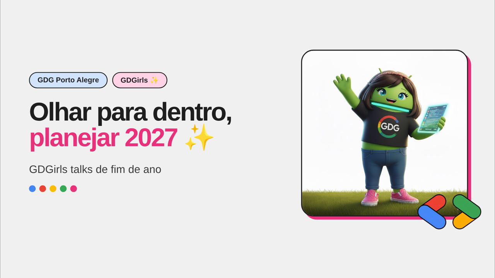

<p align="center">
  
</p>

<h1 align="center">Olhar para dentro, planejar 2027 ✨</h1>

<p align="center">
  <b>O deck completo do GDGirls talks de fim de ano: a abertura com a roda da vida e as talks da tarde.</b>
</p>

<p align="center">
  
  
  
</p>

---

## 💗 Sobre o encontro

O **GDGirls talks de fim de ano** foi um encontro do GDG Porto Alegre no Instituto Caldeira, na sala da FIAP, pra celebrar o que deu certo, falar dos desafios sem filtro e começar a pensar em 2027 com calma. Sem fórmula pronta e sem cobrança.

Eu abri a tarde apresentando o GDG Porto Alegre e o GDGirls, agradecendo quem fez o encontro acontecer e puxando a primeira dinâmica: **a roda da vida**.

Esse deck reúne a tarde inteira, na ordem em que aconteceu: a abertura, as talks da Jaqueline e da Vitória, o break, o encerramento, os sorteios e a nossa foto juntas.

## 🎯 A dinâmica

Antes de planejar 2027, a gente precisa saber onde está agora. A roda da vida divide a vida em 12 áreas, e cada pessoa dá uma nota de 0 a 10 pra cada uma. O desenho que aparece mostra onde a vida está cheia e onde está pedindo cuidado.

1. **A folha é sua:** cada uma levou a roda impressa pra fazer em casa, com calma.
2. **Monte um momento só seu:** peça aquele iFood, luz baixa, música ambiente, celular no silencioso e preste atenção em você.
3. **Olha o formato:** se fosse uma roda de bicicleta, ela rodaria?
4. **Responde quatro perguntas:** qual nota surpreendeu, qual área puxaria as outras, o que está bom e não quero perder, e se essa nota é minha ou é a régua dos outros.
5. **Escolhe uma área só:** e uma ação pequena pra próxima semana.

E fechamos com um **pacto entre mulheres**: olhar pra girl do lado e dizer em voz alta "eu me comprometo comigo mesma". Falar em voz alta gera compromisso. E, quando a gente fala, a gente também se escuta.

## 📱 Leve pra casa

A roda também tem versão online pra fazer no celular, salvar e refazer em junho:

### 👉 [minha-roda-da-vida.vercel.app](https://minha-roda-da-vida.vercel.app)

O código do app está em [masbahguriatech/minha-roda-da-vida](https://github.com/masbahguriatech/minha-roda-da-vida).

## 🗓️ Programação da tarde

| Horário | Atividade | Com |
|---|---|---|
| 14h15 | Abertura + dinâmica: como está a sua roda da vida hoje? | Fernanda dos Santos · GDG Porto Alegre |
| 14h50 | Pertencer, provar, cuidar: saúde mental de mulheres na tecnologia (e maternidade) | Jaqueline Michaelsen · Growdev |
| 15h20 | Break | |
| 15h30 | Carreira aumentada: IA e competências humanas para se destacar em 2027 | Tracy Freitas · FIAP |
| 16h10 | Checklist 2027: o que quem contrata quer ver (e por que você deve ser você) | Vitória Santos · Growdev |
| 16h40 | Encerramento e sorteios | |

## 🙏 Obrigada

- **FIAP**, que recebeu a gente, e a **Marina Alano**, nossa anfitriã
- **Growdev**, patrocínio Gold
- **Jaschek Gastronomia**, patrocínio
- Organização: Fernanda dos Santos, Giovane Roxo e GDG Porto Alegre
- **Jaqueline Michaelsen**, **Tracy Freitas** e **Vitória Santos**, que dividiram a tarde com a gente

Os slides das talks são das palestrantes e estão aqui com o conteúdo de cada uma.

## ▶️ Como apresentar

Abra o `index.html` no navegador. Não tem build nem dependência.

| Tecla | O que faz |
|---|---|
| `→` `espaço` `enter` | próximo slide (ou próxima pergunta, nos slides com revelação) |
| `←` | slide anterior |
| `F` | tela cheia |
| `N` | mostra e esconde as notas de fala |

No celular dá pra passar com swipe ou tocando no lado direito da tela. Pra abrir direto num slide, use o número no fim do link, como `index.html#14`.

Tem também um PDF de backup com os 66 slides: `olhar-para-dentro-planejar-2027.pdf`.

## 🗂️ Arquivos

```
index.html                              o deck inteiro (HTML + CSS + JS)
olhar-para-dentro-planejar-2027.pdf     backup em PDF, um slide por página
img/                                    fotos, logos e QR codes dos slides
img/jaqueline/                          slides da talk da Jaqueline Michaelsen
img/vitoria/                            slides da talk da Vitória Santos
```

O QR code do GDG Porto Alegre, o do grupo do GDGirls no WhatsApp e o da Minha roda da vida estão em `img/`.

## 💬 Bora conversar

Me conta qual área você escolheu cuidar em 2027 💗

<p>
  <a href="https://www.instagram.com/masbahguriatech/"></a>
  <a href="https://www.linkedin.com/in/fernanda-dossantos"></a>
</p>

---

<p align="center">Feito com 💗 por <a href="https://www.instagram.com/masbahguriatech/">@masbahguriatech</a> para o GDGirls · GDG Porto Alegre</p>
